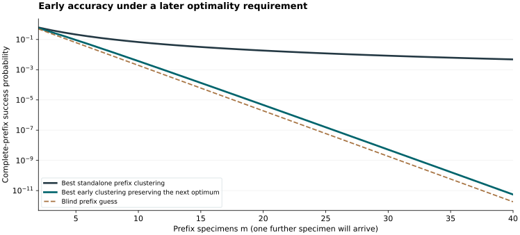

# Quantum Clustering Early Readout

**What can a learner reveal before all its quantum data arrive, while keeping the best possible final clustering accuracy?** This project gives an exact timing law and the most informative compatible early classical readout.

Each of the $`n`$ native quantum specimens is prepared in one of two unknown, independently Haar-random pure states in local dimension $`d\ge2`$. Binary labels are independent and uniform. The goal is to recover the entire partition of positions, with the two class names interchangeable. An early instrument may keep an arbitrary quantum output, but its later continuation must attain the unrestricted Bayes-optimal full-partition success probability.

| Specimens still to arrive | Classical partition information that can be released without reducing the final optimum |
| --- | --- |
| At least two | None: every early outcome has the same likelihood for every hidden partition. |
| Exactly one | A constrained noisy statistic of the unordered cluster sizes; no information distinguishing different orderings of the same sizes. |
| None | The established optimal collective clustering measurement is available. |

The statement covers arbitrary early instruments and outcome-dependent final measurements. It concerns record likelihoods on the specified ensemble. It does not assert that every uninformative operation is harmless or that every physical instrument is unique.

## The complete early-readout experiment

For the penultimate prefix, put $`m=n-1`$, $`r=\lfloor m/2\rfloor`$, and let $`P_j`$ project onto its occupied Schur sector with second-row length $`j`$. A symmetry-reduced free POVM has effects $`E_a=\sum_j\theta_{a,j}P_j`$ exactly when

```math
\theta_{a,j}\ge0,\qquad
\sum_a\theta_{a,j}=1,\qquad
\theta_{a,j}\le(n-2j+2)\theta_{a,j-1}\quad(1\le j\le r).
```

These inequalities define one canonical readout from which **every free classical record's partition likelihoods can be obtained by classical postprocessing**. The construction is maximal in the Blackwell information order. It also gives the exact optimal early full-partition success for every $`n`$ and $`d`$.

For qubits, the first examples are:

| Final specimens | Prefix specimens | Best early success preserving the final optimum |
| ---: | ---: | ---: |
| 3 | 2 | $`7/12`$ |
| 4 | 3 | $`5/16`$ |
| 5 | 4 | $`47/270`$ |
| 6 | 5 | $`71/768`$ |

At fixed local dimension, the exact free-prefix success is $`\Theta_d(2^{-n}\log n)`$. The inherited unrestricted full-array optimum instead decreases polynomially. This contrast is an **exact-preservation** result; a uniform law allowing a small final accuracy loss is not established.



The figure compares the same prefix size under standalone classification, classification constrained to preserve the next full-array optimum, and blind guessing. Every plotted value uses the exact finite formula. [Figure values and generator](figures/make_frontier.py) are provided.

## Read the science

Start with the [connected scientific route](science/README.md) or the [source model and exact success convention](science/model.md).

| Question | Authoritative account |
| --- | --- |
| What is inherited about optimal final clustering, and why does equality constrain every continuation? | [Optimal measurement and dual supports](science/optimal_measurement.md) |
| Which rank-one permutation frames appear, including balanced classes? | [Harmonic frames](science/harmonic_frames.md) |
| Why do one and two missing arrivals have different information boundaries? | [Temporal rigidity](science/temporal_rigidity.md) |
| What is the most informative free experiment? | [Complete free-readout family](science/free_readout.md) |
| How accurate can the early clustering be? | [Exact prefix accuracy](science/prefix_accuracy.md) |
| What survives if final optimality is approximate? | [Finite-size stability and its limits](science/stability.md) |
| What do the timing law and construction mean physically? | [Interpretation](science/interpretation.md) and [resources](science/resources.md) |
| Which results and constructions are established prior work? | [Related work](references/RELATED_WORK.md) and [bibliography](references/references.bib) |

[llms.txt](llms.txt) maps scientific questions to their canonical sources.

## Learn the construction

The [learning route](learning/README.md) is anchored in John Watrous, *The Theory of Quantum Information* (2018). Begin with the [book-to-project bridge](learning/WATROUS_BRIDGE.md), follow the [complete two-to-three-qubit example](learning/TUTORIAL.md), and use the [30-milestone map](learning/MILESTONES.md) to connect the background to the general result. The scientific pages remain the authoritative account of the proofs and their limits.

## Reproduce the finite checks

See [verification instructions](verification/README.md) for dependencies, commands, recorded results and their scope. The checks reconstruct physical small-system states and measurements, exact harmonic identities, compatible instruments and independent optimization problems. General claims rest on the written proofs; finite checks do not establish priority or certify mathematical correctness.

## Scope

The model uses pure prototypes, the stated Haar/uniform prior, one specimen at every known position, exact Bayesian recovery of the whole partition and ideal operations. The explicit early realization retains the prefix and later uses a conditional global measurement. All outcomes count.

No result is claimed for Hamming loss, arbitrary mixed clusters, adversarial or drifting sources, noisy hardware, optimal memory compression, efficient measurement synthesis or a classical-data runtime speedup. For $`d>2`$, physical effects on source-null Schur sectors are unobservable and are completed without changing ensemble statistics.

## Purpose and contact

This repository serves as a record of the work and a guide for the author’s self-directed learning. For discussion or potential collaboration, please contact Ruge Lin at [gogoko699@gmail.com](mailto:gogoko699@gmail.com).
